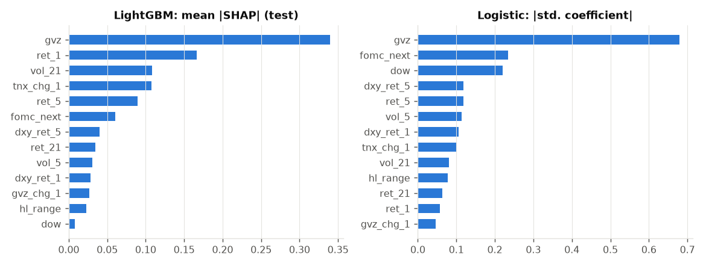
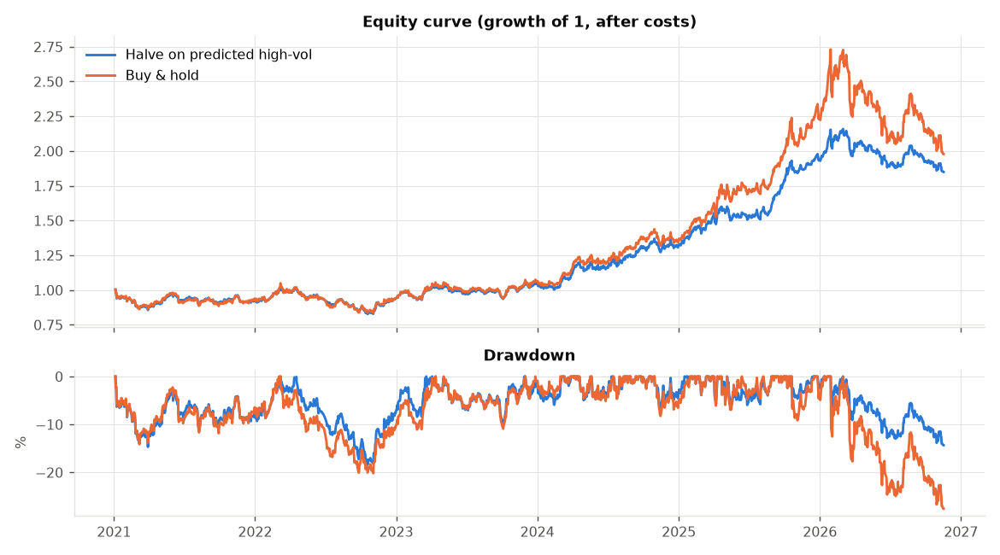
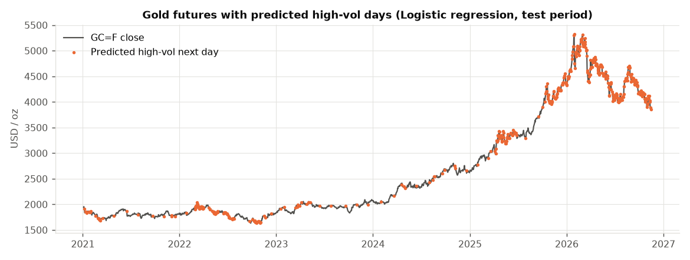

# Predicting High-Volatility Days in Gold Futures

Can we tell, at today's close, whether **tomorrow** will be a big-move day for gold, and is that useful for risk management?

**Short answer:** somewhat. The best model reaches a test ROC-AUC of **0.65**. That is only a little better than ranking days by the gold volatility index (GVZ) alone, which scores 0.64. Logistic regression beats LightGBM. The FOMC flag gives a small but statistically significant improvement. Halving the position on flagged days cut max drawdown from −27.6% to −18.3% and raised Sharpe from 0.72 to 0.82, at the cost of 1.3 points of annual return. Nearly all of that gain comes from the 2025–26 high-volatility regime, not from picking individual days.

## Problem
- **Label:** `y_t = 1` if gold's absolute log return on day t+1 is in the top 20% of days, else 0. The cutoff (|r| > **1.117%**) is the 80th percentile of the **training period only** (2010–2020).
- **Prediction time:** the close of day t, using only data available then.

## Data
yfinance daily data since 2010-01-01:

| Ticker | Series | Used for |
|---|---|---|
| `GC=F` | Gold futures (continuous front month), OHLC | returns, volatility, range, the label |
| `^GVZ` | CBOE gold volatility index | implied vol level and change |
| `DX-Y.NYB` | US dollar index | dollar returns (gold usually moves the other way) |
| `^TNX` | 10Y Treasury yield | yield change (a proxy for real rates) |

- Gold's trading days are the calendar. The other three series are put on those dates and forward-filled by **at most 1 day**. This filled 3 GVZ, 2 DXY and 4 TNX gaps, and no rows had to be dropped. Result: 4,245 rows (2010-01-04 to 2026-11-17).
- Gold itself is never filled, because a filled close would create a fake 0% return.
- ⚠️ **`GC=F` is a continuous contract with roll jumps.** Yahoo splices successive front-month contracts without back-adjusting, so on roll days (about every two months) the return includes the price gap between contracts. Some "high-vol" labels and some strategy P&L may be roll artifacts rather than real moves.
- 149 days have `high == low` (Yahoo only has a settle price on those days). Their high-low range is set to missing, not 0%.
- `data/fomc_dates.csv` is the file from my FOMC event study (2015 to April 2026), extended here with **2010–2014 scheduled meetings** and **June–October 2026 meetings** (decision marked `unknown`). Without them the flag would be 0 on real FOMC days. ⚠️ The added rows came from memory, so check them against the [Fed calendar](https://www.federalreserve.gov/monetarypolicy/fomccalendars.htm).

## Features (all known at day t's close)
| Group | Features |
|---|---|
| Gold | 1/5/21-day log returns, 5/21-day rolling volatility, high-low range % |
| GVZ | level, 1-day change |
| Dollar | 1-day and 5-day log returns |
| Rates | 10Y yield 1-day change (percentage points) |
| Calendar | day of week |
| FOMC | `fomc_next` = 1 if the Fed announced a decision on day t. Gold settles at 1:30pm ET, before the 2pm statement, so the reaction shows up on t+1 |

## Method
- **Split by time:** train on signal dates 2010–2020, test on 2021 onward (1,478 days). No shuffling anywhere.
- **All choices made on training data only**, using expanding-window CV by year (validate on 2015 … 2020, each time training on all earlier years):
  - LightGBM hyperparameters (8-point grid; small trees won: 7 leaves, 200 rounds, learning rate 0.02).
  - The probability cutoff for "predicted high-vol": the 80th percentile of out-of-fold training predictions.
  - Whether the FOMC flag goes into the main model.
  - Which model runs the strategy (logistic regression, on CV AUC).
- **Models:** logistic regression (median imputation, standardisation, one-hot day of week) vs LightGBM.
- **Benchmark:** the GVZ level by itself, with no model.
- The test set is scored once, by models refit on all of 2010–2020.

## Results

Test period: 2021-01-04 to 2026-11-16. **Test base rate: 25.8%**, higher than 20%, because gold has been more volatile than in 2010–2020.

### Classification

| Model | Features | CV AUC (train) | **Test AUC** | Precision | Recall | Flagged |
|---|---|---|---|---|---|---|
| Logistic regression | base | 0.589 | 0.637 | 37.3% | 46.6% | 32.3% |
| LightGBM | base | 0.576 | 0.621 | 36.6% | 45.0% | 31.8% |
| **Logistic regression** | **base + FOMC** | **0.607** | **0.651** | 39.9% | 46.9% | 30.4% |
| LightGBM | base + FOMC | 0.583 | 0.639 | 39.5% | 46.1% | 30.2% |
| GVZ level only (no model) | gvz | 0.578 | 0.640 | 42.4% | 37.7% | 23.0% |

Confusion matrices on test (with FOMC flag):
- Logistic regression: TN 826, FP 270, FN 203, TP 179
- LightGBM: TN 826, FP 270, FN 206, TP 176

Main takeaways:
1. **LightGBM doesn't beat the baseline.** It loses to logistic regression in both CV and test, with and without the FOMC flag. With about 2,700 noisy training rows and one dominant, roughly monotonic signal (GVZ), the extra flexibility doesn't pay off.
2. **Most of the signal is GVZ.** GVZ by itself matches the base logistic model on test AUC (0.640 vs 0.637). Both models rank GVZ as the top feature (chart below).
3. **The FOMC flag helps, a little but reliably.** Test AUC with the flag minus without (95% block-bootstrap CI, 20-day blocks):
   - Logistic regression: **+0.015** [+0.005, +0.025]
   - LightGBM: **+0.018** [+0.007, +0.030]

   The day after an FOMC decision was high-vol **46%** of the time in training (87 events, vs 19% on other days) and **53%** in test (47 events, vs 25%). This matches the day+1 effect from the event study. The flag was chosen on training CV first, and the test result agrees.



### Strategy check (test period, 0.05% cost per position change)
Hold GC=F. Use a 0.5 position on days after a predicted high-vol day, otherwise 1.0.

| Strategy | Ann. return | Ann. vol | Sharpe | Max DD | Avg exposure | Position changes |
|---|---|---|---|---|---|---|
| Halve, logistic regression | 11.0% | 14.0% | **0.82** | **−18.3%** | 0.85 | 193 |
| Halve, LightGBM | 11.4% | 14.3% | 0.83 | −19.5% | 0.85 | 301 |
| Buy & hold | **12.3%** | 18.7% | 0.72 | −27.6% | 1.00 | 0 |



How much of this is real skill? Three checks:

- **Random-halving control.** Halving the same number of days at random gives a median Sharpe of 0.69 before costs (5–95% range: 0.50–0.89). The logistic strategy scores 0.94 before costs, better than 98.6% of random runs. The flagged days really are riskier: mean next-day |return| was 1.20% on flagged days vs 0.68% on other days, and the mean return was lower on flagged days too.
- **But it's a regime filter, not day-picking.** The share of days at half position by year:

  | 2021 | 2022 | 2023 | 2024 | 2025 | 2026 |
  |---|---|---|---|---|---|
  | 10% | 27% | 6% | 6% | 42% | **100%** |

  In 2021–2024 the strategy and buy-and-hold have the **same Sharpe (0.58 vs 0.59)**. All of the improvement comes from 2025–26, when GVZ stayed high and the model flagged almost every day, so the strategy simply held half a position through the 2026 drawdown. This is closer to volatility targeting than to forecasting specific days. Because the label cutoff is fixed at the 2010–2020 level, the model is bound to flag everything in a high-vol regime.
- **Strict timing** (see look-ahead section): logistic regression still beats buy-and-hold on Sharpe (0.78 vs 0.72, max DD −19.4%). LightGBM falls below it (Sharpe 0.62), so its edge partly depends on macro data from after gold's 1:30pm settle.



Every generated number is in [`results/results.md`](results/results.md).

## Where look-ahead bias could creep in
| Risk | How it's handled |
|---|---|
| Label threshold computed on the full sample | 80th percentile from training rows only |
| Hyperparameters, cutoff or feature set tuned on test | All chosen by expanding-window CV inside 2010–2020; test scored once |
| Train/test boundary | The last training row's label is the first test day's return, so it's purged; the same purge is applied in every CV fold |
| Rolling features | Trailing windows only; the label is the only forward `shift(-1)` |
| Forward-filling | Copies past values only, max 1 day; gold itself is never filled |
| **Intraday timing** | Gold settles at 1:30pm ET, but GVZ (4:15pm), DXY (~5pm) and the 10Y yield close later. The main backtest trades at gold's settle using data that wasn't public yet, a few hours of look-ahead. In practice you'd trade in the evening Globex session at a slightly different price. The **strict-timing** variant lags all macro features by one day. AUC drops only 0.005 for logistic regression (0.651 → 0.646) but 0.025 for LightGBM |
| Strategy execution | The position earning day t+1's return is set from day t's prediction |
| FOMC flag | Matched on the exact announcement date. The 2020-03-15 (Sunday) emergency cut tags no row instead of being moved back to Friday, which would be look-ahead. Scheduled dates are public well in advance |
| Data revisions / survivorship | Not an issue for these market series, but Yahoo history can be quietly revised |

## Limitations
- **Roll jumps** in `GC=F` (see Data). A back-adjusted continuous series would be cleaner.
- **Regime drift.** The fixed 2010–2020 threshold labels 43% of 2026 days as high-vol. A rolling-percentile label (e.g. top 20% of the trailing year) would test day-level skill more fairly.
- **Modest signal.** An AUC of 0.65 means many false alarms: 270 false positives vs 179 true positives.
- **One test window** (about 6 years, a single gold bull market and its 2026 pullback). The block bootstrap helps, but it's still one path.
- **FOMC timing details.** In 2011–2012 the statements at press-conference meetings came out at 12:30pm, before gold's settle, so for those the reaction lands on day 0, not day+1. The emergency cut on 2020-03-03 was at 10am. The flag ignores both.
- **Costs and carry.** A flat 0.05% per change, no slippage model, and no interest on the cash freed by halving (this applies to both strategies).
- Close-to-close daily data can't separate the 2pm Fed reaction from everything else that happened that day.

## Run it
```bash
python -m venv .venv && source .venv/bin/activate
pip install -r requirements.txt     # macOS: LightGBM also needs `brew install libomp`
python data.py       # download + data-quality checks (cached in data/raw_prices.csv)
python model.py      # train/evaluate everything -> results/run.pkl (~40s)
python backtest.py   # strategy stats for both models
python report.py     # README charts + results/results.md
streamlit run app.py # dashboard
```

| File | Role |
|---|---|
| `data.py` | download, cache, align, forward-fill |
| `features.py` | features and training-only label threshold; look-ahead notes |
| `model.py` | walk-forward CV, LR vs LightGBM, FOMC test, SHAP |
| `backtest.py` | halve-on-signal strategy, costs, random control |
| `report.py` | static charts and results tables for this README |
| `app.py` | Streamlit dashboard (price + signals, metrics, importance, equity, drawdown) |
